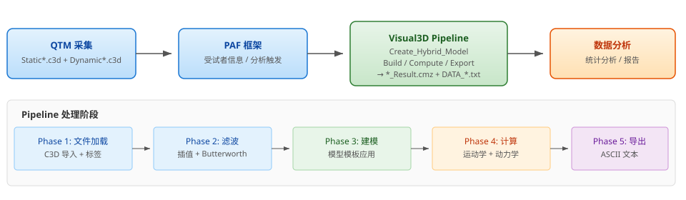
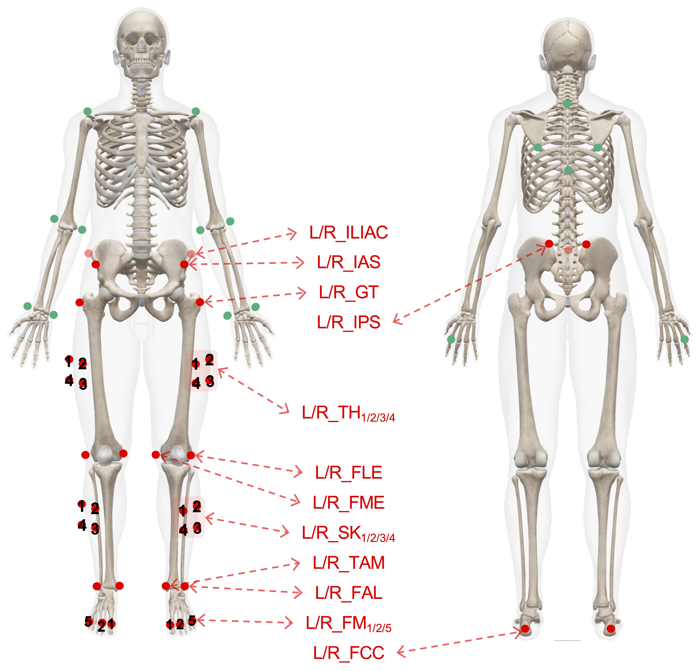
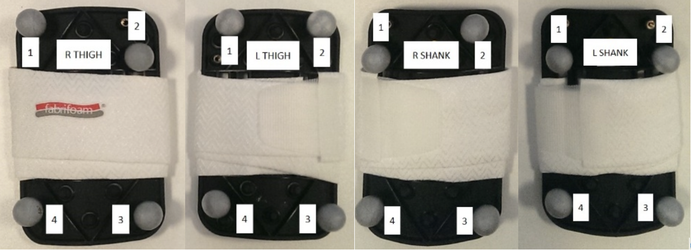

# PAF_Qualisys: 运动生物力学数据采集与处理 SOP

**Author:** Heng Lu  | 
**版本：**1.5.0  | 
**日期：**2026/10/16  | 
**适用项目：**`PAF_v3d`  | 
**处理引擎：**Visual3D 2024.10.4+

基于 **Qualisys Track Manager (QTM)** 采集的三维动作捕捉数据与力台数据，配合 [**Project Automation Framework (PAF)**](https://github.com/qualisys/paf-visual3d-example) 驱动 **Visual3D** 自动建模、运动学/动力学计算与数据导出。本文覆盖采集准备、贴点方案、模型选择逻辑、滤波参数、Pipeline 处理流程、质量控制和输出规范。

> 下文的项目目录描述本地 `PAF_v3d` 工程；其中所列配置与模板文件尚未上传本仓库。

- 四点追踪板 / 三点节段贴点自动选择
- 骨盆共用；躯干按 C7 调用
- Double / Dominance 导出

## 目录

- [1. 系统架构与数据流程](#s1)
- [2. 项目目录结构与工作流](#s2)
- [3. PAF 配置与自动化机制](#s2a)
- [4. 采集前准备](#s3)
- [5. 滤波与插值参数](#s4)
- [6. 贴点方案与命名规则](#s5)
- [7. 模型分段与自动选择逻辑](#s6)
- [8. 详细建模规格 分段定义与参数](#s6a)
- [9. Pipeline 处理流程详解](#s7)
- [10. 动力学计算与数据导出](#s8)
- [11. 表面肌电粘贴、采集与数据处理方案](#s8d)
- [12. 质量控制与故障排除](#s9)
- [13. 建议记录表](#s10)
- [14. 版本说明与参考资料](#s11)

<a name="s1"></a>

## 1. 系统架构与数据流程



整体数据流：**QTM 采集 C3D** → **PAF 触发** → **Visual3D 命令行 /s 模式** → **Pipeline 自动处理** → **\*\_Result.cmz + DATA\_\*.txt**。

**PAF 分析类型：**  
- `Processing Double`：调用 `pipeline_create_workspace.v3s`，导出双侧数据  
- `Processing Dominance`：调用 `pipeline_create_workspace_Dominance.v3s`，根据受试者 `Dominance` 字段导出优势侧数据  
- `Export c3d`：调用 `pipeline_export_c3d.v3s`，导出处理后的 C3D  
- `Generate .trc and .sto`：生成 OpenSim 格式文件

<a name="s2"></a>

## 2. 项目目录结构与工作流

```
PAF_v3d/
├─ AIM models/           ← QTM AIM 骨骼求解器模型
│  ├─ Cast_Lower&Upper.qam
│  ├─ Sports_Static.qam
│  └─ Sports_Dynamic.qam
├─ Calibrations/          ← 相机校准文件
├─ Data/
│  └─ {受试者ID}/
│     └─ {日期}/
│        ├─ Static*.c3d            ← 静态标定文件（1个）
│        ├─ Dynamic*.c3d           ← 动态任务文件（1-50个）
│        ├─ *_Result.cmz           ← Visual3D 工作空间
│        ├─ DATA_Angle.txt         ← 关节角度
│        ├─ DATA_Segment.txt       ← 分段角（相对实验室）
│        ├─ DATA_Moment.txt        ← 关节力矩（体重标准化）
│        ├─ DATA_Power.txt         ← 关节功率（体重标准化）
│        ├─ DATA_Angular_Velocity.txt ← 角速度
│        └─ DATA_CoM.txt          ← 质心位置
├─ Documentation/         ← PDF 参考文档
│  ├─ Marker_Guide_Sports_Marker_Set.pdf
│  ├─ Sports Marker Set.pdf
│  ├─ CAST_Marker_Set_Full_Body.pdf
│  ├─ QTM user manual.pdf
│  └─ ... (更多参考文件)
├─ Messages/
│  ├─ error.txt            ← Pipeline 运行日志
│  └─ Messages YYYY-MM-DD.log
├─ Templates/
│  ├─ pipeline_create_workspace.v3s         ← 双侧输出 Pipeline
│  ├─ pipeline_create_workspace_Dominance.v3s ← 优势侧输出 Pipeline
│  ├─ pipeline_Modelcomputing.v3s           ← 运动学/动力学计算
│  ├─ pipeline_Export_Data.v3s
│  ├─ pipeline_export_c3d.v3s
│  ├─ Model_Pelvis_Coda.mdh                 ← 骨盆共用模型
│  ├─ Model_Trunk.mdh                       ← 躯干模型（静态 C7 存在时调用）
│  ├─ Model_Cast_Lower_Body.mdh             ← 四点追踪板刚体下肢
│  ├─ Model_Sports_Lower_Body.mdh           ← 三点节段贴点下肢
│  ├─ Muscle.v3s
│  ├─ report.rgt
│  └─ logo.png
├─ Settings.paf           ← PAF 项目配置
├─ Settings.qtmproj       ← QTM 项目文件
├─ README.md
└─ CHANGELOG.md
```

**标准操作流程：**

1. 在 QTM 中录入受试者信息：`ID`、`Name`、`Height` (m)、`Weight` (kg)、`Dominance` (Left/Right)、`Sex`。
2. 采集 **1 个静态文件**（`Static*.c3d`），用于模型标定。
3. 静态试验确认双侧大腿和小腿各 `_1–3` 及模型所需膝、踝、足部标记完整；记录四个 `_4` 是否全部存在。
4. 采集 **1-50 个动态文件**（`Dynamic*.c3d`），用于运动学和动力学计算。
5. 确认静态和动态文件均被标记为 `Used`。
6. 在 QTM 中选择分析类型（`Processing Double` 或 `Processing Dominance`），触发 Visual3D Pipeline。
7. 等待 Visual3D 实际处理结束，再检查 `Messages/error.txt`；`Settings.paf` 配置为 `Do not wait for Application: Yes`，PAF 返回不代表处理完成。
8. 核查本次新生成的 `*_Result.cmz` 与各 `DATA_*.txt`，确认文件非空、试验数和列数符合预期。
9. 导出数据用于后续统计分析。

<a name="s2a"></a>

## 3. PAF 配置与自动化机制

### 3.1 Settings.paf — 项目配置文件

`Settings.paf` 是 PAF 项目的核心配置文件，采用 **YAML 1.2** 格式。QTM 加载项目时自动读取该文件并重新配置项目视图（含树形结构、字段定义、分析菜单等）。**修改后需重启 QTM 并重新加载项目**才能生效。

主要配置段：

| 配置段 | 作用 | 本项目设定 |
| --- | --- | --- |
| `Globals` | 项目根设置：Project ID、日期/时间格式、文件名过滤器、默认字段 | `Project ID: PAF_v3d`；日期格式 ISO；24 小时制 |
| `Package Information` | 包元数据：名称、版本、最低 QTM 版本要求、编码声明 | 版本 `1.0.5`；要求 QTM ≥ `2.16.3600`；ANSI 编码 |
| `Types` | 定义项目层级结构（类/类型/子项），含字段默认值和可用的分析列表 | Subject → Session → Measurement（静态/动态） |
| `Measurements` | 测量类型定义（静态标定 / 动态任务），含采集参数 | Static（1个）、Dynamic（1–50个） |
| `Analyses` | 定义可用分析及其类型、前置条件、模板文件、输出文件 | Processing Double / Dominance / Export c3d / Generate .trc .sto |
| `Fields` | 全局字段定义：类型（Integer/Float/String/Enum/Boolean）、默认值、约束、单位 | ID, Name, Height, Weight, Dominance, Sex, DOB, Comments 等 |
| `Columns` | 树视图列配置（列名、宽度、绑定字段） | — |

**本项目分析执行模式：**`Session` 类型同时定义了 `Measurements` 和 `Analyses`（见上方 Settings.paf），测量文件（Static / Dynamic）直接位于 Session 文件夹下，分析逐个 Session 执行。所有分析均通过 `External program` 类型调用 Visual3D（参数 `/s` 静默模式），PHP 预处理 `.v3s` 模板后执行。

### 3.2 PHP 模板预处理

PAF 在执行 Visual3D 分析前，使用内置 **PHP 引擎**对 Pipeline 模板（`.v3s`）进行预处理。流程如下：

1. QTM 导出当前 Session 的元数据为 `session.xml`
2. PHP 解析 `session.xml`，填充 `$subject`、`$session`、`$measurements` 等变量
3. PHP 处理 Pipeline 模板中的 `<?= ... ?>` 占位符，替换为实际路径和参数值
4. 生成最终的 Pipeline 脚本，传递给 Visual3D 执行

**常用 PHP 变量：**

| 变量 | 含义 | 示例值 |
| --- | --- | --- |
| `$working_directory` | 当前 Session 的工作目录 | `C:\...\Data\S001\2026-05-27` |
| `$template_directory` | Templates 文件夹路径 | `C:\...\PAF_v3d\Templates` |
| `$analysis_name` | 当前执行的分析名称 | `Processing Double` |
| `$subject['Height']` | 受试者身高 (m) | `1.735` |
| `$subject['Weight']` | 受试者体重 (kg) | `74.31` |
| `$subject['Dominance']` | 优势侧 | `Right` / `Left` |
| `$m['Used']` | 测量文件是否被勾选 | `true` / `false` |
| `$m['Measurement_type']` | 测量类型 | `Static` / `Dynamic` |
| `$batch_processing_info` | 批处理标记 (QTM 2026.1+) | `"batch"` 或空字符串 |

**模板示例：**

```
! 模板中（.v3s 源文件）
/FILE_NAME=<?=$working_directory;?>Static*.c3d

! 实例化后（传入 Visual3D 的实际脚本）
/FILE_NAME=C:\PAF_v3d\Data\S001\2026-05-27\Static*.c3d
```

**PHP 换行注意：**PHP 的 `?>` 标签会吞掉紧随其后的换行符。如需保留换行，在 `?>` 后加一个空格：`<?=$var;?>` 。

### 3.3 本项目分析类型

| 分析名称 | 类型 | 模板 / 程序 | 输出文件 | 说明 |
| --- | --- | --- | --- | --- |
| `Processing Double` | `External program` | `pipeline_create_workspace.v3s` | `DATA_*.txt` (双侧) | 调用 Visual3D `/s` 静默模式，标准双侧输出 |
| `Processing Dominance` | `External program` | `pipeline_create_workspace_Dominance.v3s` | `DATA_*.txt` (优势侧) | 根据 `Dominance` 字段仅输出优势侧数据 |
| `Export c3d` | `External program` | `pipeline_export_c3d.v3s` | `*.c3d` | 导出处理后的 C3D（滤波后 marker + 力学数据） |
| `Generate .trc and .sto` | `Instantiate template` | `OpensimRunProcessing.php` | `*.trc` + `*.sto` | 生成 OpenSim 格式运动学/动力学文件 |

<a name="s3"></a>

## 4. 采集前准备

| 项目 | 要求 | 说明 |
| --- | --- | --- |
| 相机系统校准 | 残差 < 实验要求上限 | 确保捕捉体积覆盖完整运动范围 |
| 力台校准 | 力方向、零点、坐标系正确 | 力台零点偏移直接影响关节力矩计算 |
| 采样率 | 由 QTM 设定 | Pipeline 自动读取 `PARAMETERS::POINT::RATE` 并计算插值窗口 (RATE × 0.1) |
| 受试者体重 | 真实体重 (kg)，**不能为 0** | 体重为 0 导致体重标准化力矩/功率不可靠，触发 `WARNING!! Weight not specified or invalid!` |
| 受试者身高 | 真实身高 (m) | 范围 0.50–2.50 m |
| 文件标记 | 静态和动态文件均标记为 `Used` | PAF 仅导出标记为 Used 的测量数据 |
| AIM 模型 | 静态使用 `Sports_Static.qam`，动态使用 `Sports_Dynamic.qam` | 根据贴点方案选择对应的 AIM 模型 |

<a name="s4"></a>

## 5. 滤波与插值参数

下表描述主 Pipeline 对已打开的 `Dynamic*.c3d` 执行的插值和滤波。静态 `Static*.c3d` 随后用于模型标定与 `ORIGINAL` 目标存在性判断。

| 数据类型 | 处理 | 参数 | Pipeline 命令 |
| --- | --- | --- | --- |
| Marker / TARGET | 插值 (Interpolate) | 最大 gap = 采样率 × 0.1（200 Hz → 20 帧） | `Interpolate /MAXIMUM_GAP=::GAP` |
| Marker / TARGET | 低通 Butterworth | **Double：15 Hz；Dominance：10 Hz** | `Lowpass_Filter /FREQUENCY_CUTOFF=15` 或 `10` |
| Force (力台) | 低通 Butterworth | **50 Hz** | `Lowpass_Filter /FREQUENCY_CUTOFF=50` |
| Analog (GRF) | 低通 Butterworth | **50 Hz** | `Lowpass_Filter /FREQUENCY_CUTOFF=50` |
| 力台阈值 | Set\_Force\_Platform\_Threshold | **20 N** | `Set_Force_Platform_Threshold /THRESHOLD=20` |

**滤波参数注意事项：**

- Marker 缺失超过最大 gap 的片段会被跳过（不插值），应回到 QTM 手动检查轨迹。
- 当前 Double 为 15 Hz、Dominance 为 10 Hz；两种输出若直接比较，应先统一滤波设置并记录变更。截止频率会影响高频冲击与噪声的保留程度。
- 50 Hz Force 滤波保留更多冲击和快速加载信息，但也更容易把力台噪声和软组织伪影带入关节力矩。
- 高速变向、落地冲击或短时爆发动作应根据研究方案评估是否调整截止频率。
- **滤波参数修改必须记录在实验日志中，同一研究批次保持参数一致。**

<a name="s5"></a>

## 6. 贴点方案与命名规则

主 Pipeline 先应用共用骨盆模型；若静态文件存在 `C7`，再追加躯干模型。下肢按追踪方式选择：四个 `R_TH4、L_TH4、R_SK4、L_SK4` 全存在时使用四点追踪板刚体模型；任一缺失时，四段统一使用各自 `_1–3` 的三点节段贴点模型。

### 6.1 通用命名原则

- 左右侧统一使用 `L` / `R` 前缀或后缀。
- 名称大小写**必须与模板完全一致**。例如 `L_TH4` 不能写成 `l_th4` 或 `LTh4`。
- 如果 QTM Skeleton Solver 输出带 `Q_` 前缀，Pipeline 会自动执行 `Remove_Prefix_From_Point_Labels /PREFIX=Q_`。Visual3D 中按无 `Q_` 名称识别。
- 静态和动态文件必须使用同一套 marker 命名。
- 双侧大腿与小腿的 `_1–3` 是两种下肢模型的共同基础；若任一 `_4` 缺失，四段均按三点追踪。
- 当前主 Pipeline 不根据上肢 marker 单独切换模型；躯干段仅在静态文件检测到 `C7` 时追加 `Model_Trunk.mdh`。

### 6.2 骨盆与躯干共用部分 Common

无论下肢使用三点还是四点追踪，主 Pipeline 都会先应用骨盆共用模型；躯干模型仅在静态文件存在 `C7` 时追加：

- `Model_Pelvis_Coda.mdh`
- `Model_Trunk.mdh`（条件：`Data_Exists(TARGET::ORIGINAL::C7)`）

#### 骨盆 marker（4 点，共用）

```
R_IAS    L_IAS    R_IPS    L_IPS
```

模型：`Model_Pelvis_Coda.mdh`

#### 躯干 marker（共用）

```
C7    T10
R_SAE    L_SAE
R_SIA    L_SIA
```

模型：`Model_Trunk.mdh`；调用条件：静态文件中存在 `C7`。

**共用模型说明：**

- 骨盆不再区分 Sports\_Pelvis / Sports\_Pelvis\_IC / Cast\_Pelvis\_Coda，多方案统一使用 `Model_Pelvis_Coda.mdh`。
- 躯干不再区分 Sports\_Trunk / Cast\_Trunk；当检测到 `C7` 时，多方案统一使用 `Model_Trunk.mdh`。
- 躯干模型会使用骨盆模型生成的髂嵴 Landmark（如 `RIGHT_ILIAC` / `LEFT_ILIAC`）作为参考，因此骨盆必须先成功建模。

### 6.3 节段贴点（三点） 3 点

每侧大腿贴 `TH1–3`，每侧小腿贴 `SK1–3`。静态文件中四个 `_4` 只要有一个不存在，Pipeline 就加载 `Model_Sports_Lower_Body.mdh`，四段全部仅以 `_1–3` 追踪。文件名中的 Sports 是模板名称；这里的操作定义是三点节段贴点。

```
大腿：R_TH1 R_TH2 R_TH3    L_TH1 L_TH2 L_TH3
小腿：R_SK1 R_SK2 R_SK3    L_SK1 L_SK2 L_SK3
共用膝踝与足部点：双侧 FLE FME FAL TAM FCC FM1 FM2 FM5
```

**最低输入：**双侧 `TH/SK1–3` 和两种下肢模板共同引用的膝、踝、足部点必须在静态文件中存在；缺少 `_1–3` 中任一点不是三点模型的可用条件。检查动态试验中这些点的连续性与分布，避免把标签存在误作有效追踪。

### 6.4 追踪板刚体（四点） 4 点

每侧大腿和小腿均固定四点追踪板；四个 `R_TH4、L_TH4、R_SK4、L_SK4` 在静态文件中全部存在时加载 `Model_Cast_Lower_Body.mdh`。四段分别使用对应的 `_1–4` 追踪点。



*四点追踪板贴点示意*

**追踪板位置：**  


静态文件中四个 `_4` 标签齐全是自动选择条件；它本身不证明追踪板物理固定可靠。采集和质控时还需检查板上点间距、刚体形状稳定性、动态轨迹缺口和软组织运动。

<a name="s6"></a>

## 7. 模型分段与自动选择逻辑

**Step 1.** 先确认静态骨盆四点齐全，再以 `Static*.c3d` 标定并应用 `Model_Pelvis_Coda.mdh`。  
**Step 2.** 静态文件中存在 `C7` 时追加 `Model_Trunk.mdh`。  
**Step 3.** 核验双侧 `TH/SK1–3` 及两个下肢模板共同所需的膝踝和足部点。基础目标缺失时，不加载下肢模型，也不进入下肢计算与导出。  
**Step 4.** 四个 `TH4/SK4` 全存在 → `Model_Cast_Lower_Body.mdh`；任一缺失 → `Model_Sports_Lower_Body.mdh`，四段统一使用三点。  
**Step 5.** 写入身高体重、分配并 Build 模型，建立 Virtual Lab，再按 `lower_body_outputs` 的基础目标条件调用 `pipeline_Modelcomputing.v3s` 和导出。

| 部分 | 模型 | 条件 |
| --- | --- | --- |
| 骨盆 | `Model_Pelvis_Coda.mdh` | 先应用；须具备骨盆四点 |
| 躯干 | `Model_Trunk.mdh` | 静态 `C7` 存在时追加 |
| 下肢四点 | `Model_Cast_Lower_Body.mdh` | 基础目标齐全且四个 `_4` 全存在 |
| 下肢三点 | `Model_Sports_Lower_Body.mdh` | 基础目标齐全且至少一个 `_4` 不存在 |

<a name="s6a"></a>

## 8. 详细建模规格 分段定义与参数

以下内容按**现行主 Pipeline**整理，重点描述当前真正参与自动处理的模型模板。
与历史备份脚本相关的旧模型名称（如 `Sports_Pelvis.mdh`、`Cast_Trunk.mdh`）不再作为主流程说明依据。

**HYBRID\_SEGMENT 类型说明：**  
- `TYPE=Coda`：Coda 骨盆模型，使用 4 个 marker + Segment Depth 定义骨盆段坐标系。  
- `TYPE=Visual_3D`：标准 Visual3D 段，通过近端/远端关节中心和内外侧参考点定义段坐标系。  
- `KINEMATIC_ONLY=TRUE`：仅运动学段，不参与逆动力学计算（如 Virtual Lab, Virtual Pelvis 等）。

### 8.1 共用骨盆 Common

模型文件：`Model_Pelvis_Coda.mdh`。两种下肢追踪方案都先调用这一骨盆模型。

| 项目 | 当前设置 | 说明 |
| --- | --- | --- |
| 输入 marker | `R_IAS + L_IAS + R_IPS + L_IPS` | 四点共用命名 |
| 模型类型 | `Coda` | 基于 4 点骨盆定义 RPV |
| 核心输出 | `RPV`、`Virtual Pelvis`、`RIGHT_HIP`、`LEFT_HIP`、`RIGHT_ILIAC`、`LEFT_ILIAC` | 为下肢和躯干提供参考 |
| 用途 | 骨盆姿态、髋关节中心、虚拟实验室参考 | 后续所有模型都依赖这一层 |

**要点：**骨盆模型建不起来时，后面的躯干、下肢、Virtual Lab 和导出通常都会连锁失败。

### 8.2 共用躯干 Common

模型文件：`Model_Trunk.mdh`。两种下肢追踪方案都使用这一套躯干模型；但仅当静态文件存在 `C7` 时调用。

| 项目 | 当前设置 | 说明 |
| --- | --- | --- |
| 主要 tracking marker | `C7 + L_SAE + L_SIA + R_SAE + R_SIA + T10` | 直接来自 Trunk 模型 tracking 定义 |
| Pipeline 调用条件 | `Data_Exists(TARGET::ORIGINAL::C7)` | 无 `C7` 时跳过 `Model_Trunk.mdh`，不再因缺少躯干 marker 中断主流程 |
| 参考对象 | `R_SAE + L_SAE + RIGHT_ILIAC + LEFT_ILIAC` | 骨盆先建模后提供髂嵴 Landmark |
| 段名 | `RTA` | 单个胸腹/躯干段 |
| 当前范围 | 只建立躯干段 | 主 Pipeline 不自动追加上臂、前臂、手部或头部模型 |

**注意：**即使采集文件中包含更多上肢 marker，当前主流程也不会因为这些 marker 自动切换到 `oldmodel\Sports_Upper_Body_sports.mdh`。

### 8.3 三点下肢模型 3 点

`Model_Sports_Lower_Body.mdh` 的大腿和小腿四段分别使用双侧 `TH1–3`、`SK1–3`。本文件与四点模型的其他段定义一致；共同要求膝、踝和足部解剖标记。四个 `_4` 中任意一个在静态文件中缺失时，四段一起采用此模板。

| 项目 | 设置 |
| --- | --- |
| 四段 tracking | `R_TH1–3 / L_TH1–3 / R_SK1–3 / L_SK1–3` |
| 膝踝与足部输入 | 双侧 `FLE、FME、FAL、TAM、FCC、FM1、FM2、FM5` |
| 适用贴点 | 大腿和小腿各贴三个追踪点；不把“缺失第 4 点”解释为完整四点追踪板 |

### 8.4 四点下肢模型 4 点

`Model_Cast_Lower_Body.mdh` 的大腿和小腿四段分别使用双侧 `TH1–4`、`SK1–4`。四个第 4 点全在静态文件中存在时自动选择。膝踝、足部及骨盆输入与三点模型相同。

| 项目 | 设置 |
| --- | --- |
| 四段 tracking | `R_TH1–4 / L_TH1–4 / R_SK1–4 / L_SK1–4` |
| 物理方案 | 大腿与小腿的追踪板刚体固定牢靠；动态试验检查板上点间距和姿态稳定性 |
| 选择限制 | `Data_Exists` 仅检查静态目标信号是否存在，不能证明动态轨迹完整或刚体几何稳定 |

<a name="s7"></a>

## 9. Pipeline 处理流程详解

### 9.1 Phase 1: 文件加载与标签

**File\_New** → 清空工作空间  
**File\_Open** → 逐个打开已标记为 Used 的 Dynamic\*.c3d  
**Assign\_Tags\_To\_Files** → 为文件打上 Measurement\_type、Test\_condition、Comments 标签

### 9.2 Phase 2: 帧率提取与滤波

**Select\_Active\_File /FILE\_NAME=Dynamic** → 选择动态文件  
**Evaluate\_Expression /EXPRESSION=PARAMETERS::POINT::RATE** → 提取采样率存入 GLOBAL::FRAME\_RATE  
**Evaluate\_Expression /EXPRESSION=FRAME\_RATE \* 0.1** → 计算插值窗口 GAP\_WINDOW  
**Interpolate /MAXIMUM\_GAP=::GAP** → TARGET 插值  
**Lowpass\_Filter TARGET 15 Hz（Double）/ 10 Hz（Dominance）** → 动态 Marker 滤波  
**Lowpass\_Filter FORCE 50 Hz** → 力台数据滤波  
**Lowpass\_Filter ANALOG 50 Hz** → 模拟信号滤波

### 9.3 Phase 3: 模型构建

**Create\_Hybrid\_Model** → 基于静态文件创建混合模型  
**Remove\_Prefix\_From\_Point\_Labels /PREFIX=Q\_** → 移除 QTM Skeleton 前缀  
**Apply\_Model\_Template / Append\_Model\_Template** → 根据 marker 检测结果应用模型模板（见第 6 节自动分支逻辑）  
**Set\_Subject\_Weight & Set\_Subject\_Height** → 写入受试者体重/身高；体重只读取 `$subject["Weight"]`  
**Assign\_Model\_File** → 将模型分配给所有动态文件  
**Set\_Text\_Item** → 将元数据 (Name, ID, DOB, Weight, Comments, Creation\_date/time) 写入 GLOBAL Workspace

### 9.4 Phase 4: 虚拟实验室方向

**Build\_Model** → 首次构建，生成 RIGHT\_HIP / LEFT\_HIP landmarks  
**Evaluate\_Expression HIP\_VECTOR** → 计算左右髋关节单位向量  
优先使用 `R_IAS - L_IAS` 计算骨盆横向向量；若 IAS 不存在，则回退到 `RIGHT_HIP - LEFT_HIP` landmarks  
**Metric\_Median → ROUND → Create\_Target** → 创建 Lab orientation 目标  
**Build\_Model** → 二次构建，应用虚拟实验室方向  
**File\_Save\_As RESULT.cmz** → 保存工作空间

**虚拟实验室算法限制：**该算法假设受试者在动态试验中骨盆不会绕垂直轴大幅旋转。
如果骨盆绕垂直轴旋转超过 ~45°，虚拟实验室方向可能失效。

<a name="s8"></a>

## 10. 动力学计算与数据导出

### 10.1 运动学/动力学计算 (pipeline\_Modelcomputing.v3s)

以下计算按顺序执行——Pipeline 先计算所有运动学量，再计算动力学量：

| 类别 | 信号名称 | 函数 | 参考坐标系 | 体重标准化 |
| --- | --- | --- | --- | --- |
| 质心 | `CenterOfMass` | MODEL\_COG | — | 否 |
| 骨盆位置 | `PelvisCGPos` | SEG\_CGPOSITION | RPV | 否 |
| 骨盆角 | `Angles Right/Left Pelvic` | JOINT\_ANGLE | RTH/LTH → RPV | 否 |
| 髋关节角度 | `Angles Right/Left Hip` | JOINT\_ANGLE | RTH/LTH → Virtual Pelvis | 否 |
| 膝关节角度 | `Angles Right/Left Knee` | JOINT\_ANGLE | RSK/LSK → RTH/LTH | 否 |
| 踝关节角度 | `Angles Right/Left Ankle` | JOINT\_ANGLE | Virtual RFoot/LFoot → RSK/LSK | 否 |
| 髋力矩 | `Moment Right/Left Hip` | JOINT\_MOMENT | RPV | **是** (DEFAULT\_NORMALIZATION) |
| 膝力矩 | `Moment Right/Left Knee` | JOINT\_MOMENT | RTH/LTH | **是** |
| 踝力矩 | `Moment Right/Left Ankle` | JOINT\_MOMENT | RSK/LSK | **是** |
| 髋功率 | `Power Right/Left Hip` | JOINT\_POWER | RPV | **是** |
| 膝功率 | `Power Right/Left Knee` | JOINT\_POWER | RTH/LTH | **是** |
| 踝功率 | `Power Right/Left Ankle` | JOINT\_POWER | RSK/LSK | **是** |
| 髋角速度 | `Angular velocity Right/Left Hip` | JOINT\_VELOCITY | RPV (Cardan序列) | 否 |
| 膝角速度 | `Angular velocity Right/Left Knee` | JOINT\_VELOCITY | RTH/LTH (Cardan序列) | 否 |
| 踝角速度 | `Angular velocity Right/Left Ankle` | JOINT\_VELOCITY | RSK/LSK (Cardan序列) | 否 |
| 分段角 | `SegAngle_Pelvis/RThigh/...` | JOINT\_ANGLE | wrt Lab | 否 |
| COP | `COP_L / COP_R` | COP\_PATH | LAB + 足部局部 | 否 |
| 足前进角 | `Left/Right Foot Progression` | JOINT\_ANGLE | Virtual Lab | 否 |

**体重标准化说明：**力矩和功率通过 `DEFAULT_NORMALIZATION` 按体重标准化（Nm/kg 和 W/kg）。
如果体重为 0 或未指定，体重标准化结果不可靠。

### 10.2 数据导出

**双侧 Pipeline (pipeline\_create\_workspace.v3s)：**

| 输出文件 | 导出信号（双侧） |
| --- | --- |
| `DATA_Angle.txt` | Angles Right Hip + Angles Left Hip + Angles Right Knee + Angles Left Knee + Angles Right Ankle + Angles Left Ankle |
| `DATA_Segment.txt` | SegAngle\_Pelvis + SegAngle\_RThigh + SegAngle\_RShank + SegAngle\_RFoot + SegAngle\_LThigh + SegAngle\_LShank + SegAngle\_LFoot (wrt Lab) |
| `DATA_Moment.txt` | Moment Right Hip + Left Hip + Right Knee + Left Knee + Right Ankle + Left Ankle |
| `DATA_Power.txt` | Power Right Hip + Left Hip + Right Knee + Left Knee + Right Ankle + Left Ankle |
| `DATA_Angular_Velocity.txt` | Angular velocity Right Hip + Left Hip + Right Knee + Left Knee + Right Ankle + Left Ankle |
| `DATA_CoM.txt` | CenterOfMass (Z, Y, X 顺序) |

**优势侧 Pipeline (pipeline\_create\_workspace\_Dominance.v3s)：**

- 读取受试者 `Dominance` 字段（`Left` / `Right`）
- `Right` → 仅输出右侧髋、膝、踝数据
- `Left` → 仅输出左侧髋、膝、踝数据
- 若字段缺失或值不为 Left/Right，**默认按 Right 处理**
- Segment 导出仅包含优势侧 + 骨盆；该流程还导出 `DATA_COP.txt`

### 10.3 导出设置

|  |  |
| --- | --- |
| 精度 | `SIGNAL_PRECISION=4`（小数点后 4 位） |
| 空值处理 | `EXPORT_NAN=TRUE`（空值输出为 NaN） |
| 文件名 | `USE_SHORT_FILENAME=TRUE` |

<a name="s8d"></a>

## 11. 表面肌电粘贴、采集与数据处理方案

**适用范围：**本节用于同步采集表面肌电 (sEMG) 与动作捕捉/力台数据。当前 `pipeline_create_workspace*.v3s` 主要处理模型、运动学、动力学和导出，不自动完成 EMG 滤波、整流、包络或归一化；EMG 数据建议在 QTM/外部分析脚本中单独处理，并与 C3D 时间轴、事件和任务标签保持一致。

### 11.1 粘贴原则

| 环节 | 操作要求 | 目的 / 风险控制 |
| --- | --- | --- |
| 皮肤准备 | 必要时剃除检测部位毛发；用酒精棉片清洁皮肤油脂和表面残留，待皮肤完全干燥后再贴电极。 | 降低皮肤阻抗和 50/60 Hz 工频干扰，减少电极松动导致的噪声。 |
| 电极间距 | 双极表面电极中心距优先采用 **20 mm**；小肌肉不超过肌纤维长度的 1/4。 | 提高重复性，减少运动终板、肌腱和邻近肌肉串扰影响。 |
| 电极方向 | 电极连线应与目标肌肉肌纤维方向平行；Delsys 平行棒传感器按箭头方向对齐肌纤维长轴。 | 保证检测面跨越肌纤维方向，获得稳定、可解释的 sEMG。 |
| 贴放位置 | 优先贴在肌腹中线，避开肌腱、骨性突起、运动终板明显区域和邻近肌肉边缘。 | 提高信噪比，减少串扰和低幅值信号。 |
| 固定 | 使用双面胶、贴环、医用胶带或弹性绷带固定电极和线缆；线缆预留松弛，不得牵拉电极。 | 减少动态动作中的运动伪影和传感器脱落。 |
| 参考电极 | 根据设备要求放置参考电极；常用位置包括 C7、腕部、踝部或骨性区域，需避开目标肌肉收缩区域。 | 稳定参考电位，降低环境噪声和工频干扰。 |
| 命名 | 建议使用 `EMG_肌肉缩写_侧别`，例如 `EMG_RF_R`、`EMG_TA_L`。 | 保证与 C3D analog channel、后处理脚本和报告字段一致。 |

### 11.2 下肢肌肉贴放位置

以下 10 块肌肉来自本项目 EMG 贴点方案。具体解剖定位可结合 SENIAM individual muscle recommendations 逐一核对。

| 序号 | 肌肉 | 缩写 | 贴放位置 |
| --- | --- | --- | --- |
| 1 | 股直肌 Rectus Femoris | `RF` | 髂前上棘与髌骨上缘连线的中点。 |
| 2 | 股内侧肌 Vastus Medialis | `VM` | 髂前上棘与膝关节内侧韧带前关节间隙连线的 4/5 处，靠近髌骨。 |
| 3 | 股外侧肌 Vastus Lateralis | `VL` | 髂前上棘与髌骨外缘连线的 2/3 处，靠近髌骨。 |
| 4 | 股二头肌长头 Long Head of Biceps Femoris | `BFL` | 坐骨结节与胫骨外侧髁连线的中点。 |
| 5 | 半腱肌 Semitendinosus | `ST` | 坐骨结节与胫骨内侧髁连线的中点。 |
| 6 | 胫骨前肌 Tibialis Anterior | `TA` | 腓骨头与内踝尖端连线的 1/3 处。 |
| 7 | 腓肠肌外侧头 Gastrocnemius Lateralis | `GL` | 腓骨头与跟骨连线的 1/3 处。 |
| 8 | 腓肠肌内侧头 Gastrocnemius Medialis | `GM` | 肌肉最突出的位置，方向沿小腿长轴。 |
| 9 | 比目鱼肌 Soleus | `SOL` | 股骨内髁到内踝连线的 2/3 处。 |
| 10 | 臀大肌 Gluteus Maximus | `GMa` | 肌肉最突出的位置；SENIAM 可参考骶椎与大转子连线 50% 位置。 |

### 11.3 采集流程

1. **设备检查：**确认 EMG 接收器、电极、参考电极、同步线或 QTM analog 输入正常；记录设备型号、采样率和通道映射。
2. **皮肤准备与粘贴：**按 11.1 处理皮肤并粘贴电极；贴好后拍照或记录左右侧、通道号和肌肉缩写。
3. **静息基线：**正式任务前采集 5-10 秒静息数据，检查基线噪声和工频干扰。
4. **动作试采：**让受试者完成 1-2 次低强度目标动作，确认目标肌肉激活明显、邻近肌肉串扰不过高、传感器不松动。
5. **MVC / 归一化试验：**如需跨受试者或跨天比较，采集每块肌肉对应的最大随意收缩 (MVC) 或统一参考动作；每项建议 2-3 次，每次 3-5 秒，中间充分休息。
6. **正式动态任务：**与 QTM/C3D 同步采集，确保 EMG、marker、力台使用同一触发或同一时间轴。
7. **采后检查：**每个通道检查是否存在饱和、平线、明显脱落、突发尖峰或持续工频噪声；异常通道必须记录。

| 采集参数 | 建议 | 说明 |
| --- | --- | --- |
| 采样率 | **≥ 1000 Hz**，优先 2000 Hz | sEMG 高频成分明显，采样率过低会导致混叠和波形失真。 |
| 模拟输入 | 记录为 C3D analog channel | 通道名建议与肌肉缩写一致，如 `EMG_RF_R`。 |
| 量程 | 避免饱和 | 若最大收缩时波形顶端被截平，需调整增益或量程后重采。 |
| 同步 | 与 QTM/力台同一时间轴 | 后续分析需要按起跳、落地、支撑期等事件对齐。 |

### 11.4 数据处理

| 步骤 | 推荐处理 | 注意事项 |
| --- | --- | --- |
| 原始检查 | 先查看 raw EMG、静息基线、最大值和异常尖峰。 | 不要在未检查原始波形前直接滤波导出。 |
| 带通滤波 | 常用 **20-450 Hz**；根据设备和研究方案也可用 10-500 Hz。 | 滤波参数必须在同一研究批次保持一致。 |
| 陷波 | 仅在存在明显工频干扰时使用 50 Hz 陷波。 | 优先通过皮肤准备、参考电极和线缆固定降低噪声，不建议默认强行陷波。 |
| 整流 | 全波整流。 | 整流后用于包络、RMS 或积分肌电计算。 |
| 包络 / RMS | 线性包络：整流后低通 4-10 Hz；或使用 RMS 滑动窗 50 ms 左右。 | 研究激活时序可用较低平滑；研究幅值趋势可用 RMS 或包络。 |
| 归一化 | 优先按 MVC 峰值或 MVC 均值归一化；没有 MVC 时可按任务内峰值归一化。 | 任务内峰值只能比较同一任务内相对激活，不能替代标准 MVC 跨人比较。 |
| 时间标准化 | 按动作事件或支撑期/腾空期重采样到固定百分比。 | 与 `DATA_Angle.txt`、`DATA_Moment.txt` 等动力学输出对齐。 |

### 11.5 质量控制

| 现象 | 可能原因 | 处理 |
| --- | --- | --- |
| 静息期噪声很高 | 皮肤未清洁、参考电极接触差、线缆松动、环境工频干扰 | 重新清洁皮肤、固定线缆、检查参考电极和接地。 |
| 通道平线 | 电极脱落、通道未连接、设备未启用 | 检查硬件连接和 QTM analog channel 设置。 |
| 动作中突发尖峰 | 电极被拉扯、衣物摩擦、线缆摆动 | 重新固定传感器和线缆，必要时重采。 |
| 目标肌肉激活不明显 | 贴到肌腱或偏离肌腹，方向未沿肌纤维 | 按解剖标志重新定位，完成目标肌肉试激活。 |
| 邻近肌肉信号过强 | 电极靠近肌肉边缘或电极间距过大 | 向目标肌肉肌腹中心调整，保持合理电极间距。 |

**记录要求：**EMG 粘贴肌肉、左右侧、通道名、采样率、滤波参数、MVC 方案、异常通道和剔除理由必须写入实验记录。否则 EMG 幅值比较不可追溯。

<a name="s9"></a>

## 12. 质量控制与故障排除

### 12.1 采集后检查清单

- 静态文件的骨盆四点、双侧 `TH/SK1–3`、`FLE/FME/FAL/TAM/FCC/FM1/FM2/FM5` 是否齐全；记录四个 `TH4/SK4` 的存在情况及应选择的模型。
- 动态文件是否沿用静态命名，追踪点有无长时间缺口；四点追踪板应核查点间距与刚体形状稳定性。
- 计划建立躯干时，检查 `C7/T10/R_SAE/L_SAE/R_SIA/L_SIA` 及骨盆参考点；当前脚本只用 `C7` 判断是否追加躯干。
- 身高、体重与优势侧字段是否有效；记录 Double/Dominance 选用的 marker 滤波频率。
- 检查 `Messages/error.txt`、新生成的 `*.cmz` 和每个 `DATA_*.txt` 的时间戳、非空内容、试验数和列数。

### 12.2 error.txt 关键错误关键字

检查 `Messages/error.txt` 中是否出现以下关键字：

ERROR!
Failed to Create
DATA\_NOT\_FOUND
Unrecognized command
HIP\_VECTOR was not created
Lab orientation was not created
WARNING!! Weight not specified or invalid!

### 12.3 常见问题速查

| 问题 | 可能原因 | 处理 |
| --- | --- | --- |
| 下肢模型未加载 | 静态文件缺少基础 `TH/SK1–3`、骨盆、膝踝或足部目标 | 按 12.1 清单逐项核查原始标记，再重新建模 |
| 选择了三点模型 | 四个 `TH4/SK4` 中至少一个在静态文件中不存在 | 若原计划为追踪板刚体，核查标签和静态文件；若原计划为三点贴点，记录为预期选择 |
| 躯干模型未生成 | `C7` 缺失；或其他躯干标记/骨盆 Landmark 不完整 | 确认是否计划建躯干，检查静态目标和 Build 结果 |
| 模型已选择但输出为空 | 目标标签虽存在，模型 Build、动态轨迹、事件或计算仍可能失败 | 核查 Visual3D 日志、`*.cmz` 中段和关节信号，以及每个输出文件的新鲜度和内容 |
| 力台阈值异常 | 阈值或力台分配不正确 | 核查 `pipeline_Modelcomputing.v3s` 中的 20 N 设置和力台映射 |

### 12.4 lower\_body\_outputs 触发条件

两条主 Pipeline 目前均以与下肢模型加载相同的 32 个静态原始目标信号作为计算与导出的入口：骨盆四点、双侧 `TH/SK1–3`，以及双侧 `FLE/FME/FAL/TAM/FCC/FM1/FM2/FM5`。四个 `_4` 决定调用哪个模型，不影响基础导出入口。该条件只核验信号存在，仍须独立检查 Build 成功、动态信号、日志和新输出。

<a name="s10"></a>

## 13. 建议记录表

| 项目 | 填写内容 |
| --- | --- |
| 受试者 ID |  |
| 日期 |  |
| 测试项目 / 任务 |  |
| 贴点方案 | 三点节段贴点 / 四点追踪板刚体；记录四个 `TH4/SK4` 是否齐全 |
| 静态文件名 |  |
| 动态文件名（数量） |  |
| 身高 (m) |  |
| 体重 (kg) | **不能为 0** |
| 优势侧 | Left / Right |

<a name="s11"></a>

## 14. 版本说明与参考资料

### 14.1 PAF\_v3d 版本信息

|  |  |
| --- | --- |
| 当前 SOP 版本 | **1.4.0** (2026.10.16) |
| Settings.paf 包版本 | **1.0.5**（未改动） |
| 最低 QTM 版本 | 2.16.3600 |
| 兼容 Visual3D | 2024.10.4（推荐），向下兼容至 2023.10.2 |
| 支持贴点方案 | 三点节段贴点与四点追踪板刚体；按四个 `TH4/SK4` 自动选择 |
| 共用模型 | 骨盆：`Model_Pelvis_Coda.mdh`；躯干：`Model_Trunk.mdh`（仅 `C7` 存在时调用） |
| 下肢模型组成 | `Model_Sports_Lower_Body.mdh`（三点）或 `Model_Cast_Lower_Body.mdh`（四点） |
| 输出模式 | 双侧 (Double) / 优势侧 (Dominance) |

### 14.2 变更记录

| 日期 | 变更 |
| --- | --- |
| 2026.10.16 | 统一下肢为四点追踪板与三点节段贴点两种模板；两条主 Pipeline 改按四个 `TH4/SK4` 选择，并同步基础输入和导出入口；更新 SOP、滤波频率与导出精度说明。 |
| 2026.08.03 | 同步 Pipeline 更新：`pipeline_create_workspace.v3s` 与 `pipeline_create_workspace_Dominance.v3s` 中，`Model_Trunk.mdh` 改为仅当 `Data_Exists(TARGET::ORIGINAL::C7)` 成立时调用；无 `C7` 的静态文件将跳过躯干模型。 |
| 2026.06.14 | 按现行主流程优化 SOP：骨盆统一改为 `Model_Pelvis_Coda.mdh`，躯干统一改为 `Model_Trunk.mdh`；Sports / Cast 只对下肢分支；Sports 下肢命名更新为 `TH5/FLE/FME/SK5/FAL/FCC/FM2/FM5`；同步更新 Virtual Lab、导出条件与故障排查说明。 |
| 2026.06.04 | 在动力学计算与数据导出后新增表面肌电粘贴、采集与数据处理方案；补充下肢 10 块肌肉贴放位置、采集流程、处理流程和质量控制。 |
| 2026.06.04 | 将 Cast 下肢 Cluster 追踪板位置图在桌面端缩小为 2/3 显示，手机端仍按屏幕宽度适配。 |
| 2026.06.04 | 将 Cast/Sports 贴点方案图片在桌面端缩小为 50% 显示，手机端仍按屏幕宽度适配。 |
| 2026.06.04 | 调整贴点方案章节顺序：Cast 作为主方案放在 Sports 前；在 Cast/Sports 触发条件后加入对应贴点图，并统一图片路径到 `Documentation/Figure`。 |
| 2026.06.03 | 补充 Sports 贴点操作注意事项：骨盆、KneeIn/Functional knee、下肢关键点、躯干命名和静态/动态方向一致性。 |
| 2026.06.03 | 修正手机端多列表格宽度：根据列数自动设置表格最小宽度，避免 4 列及以上表格内容被挤压。 |
| 2026.06.03 | 增加手机端浏览器适配：目录改为移动端抽屉、表格自动横向滚动、正文路径与代码片段避免撑破屏幕，并补齐网页端 Logo 相对资源路径。 |
| 2026.06.02 | 更新 Sports functional knee 分支：旧方案在无 RKneeIn/LKneeIn 时使用功能膝分支；当时的主 pipeline 仅建立躯干、骨盆和下肢；体重改为只读取 `$subject["Weight"]`；同步美化 SOP 页面样式 |
| 2026.05.20 | 整合 Cast 模型，拆分下肢/骨盆/上肢；根据优势侧自动输出 |
| 1.0.5 | 兼容性测试：Visual3D 2024.10.4 |
| 1.0.4 | 兼容性测试：Visual3D 2024.06.1 |
| 1.0.3 | 兼容性测试：Visual3D 2024.05.3 |
| 1.0.1 | 兼容性测试：Visual3D 2023.10.2 |
| 1.0.0 | 从 paf-resources 迁移初始版本 |

### 14.3 参考资料

**项目内部文档 (Documentation/)**  
- `Marker_Guide_Sports_Marker_Set.pdf` — Sports 贴点方案指南  
- `Sports Marker Set.pdf` — Sports Marker Set 详细说明  
- `CAST_Marker_Set_Full_Body.pdf` — Cast 全身贴点方案  
- `QTM user manual.pdf` — QTM 用户手册  
- `Getting Started.pdf` — 入门指南  
- `Animation Marker Set.pdf` — 动画用 Marker Set  
- `QTM RT protocol.pdf` — 实时协议  
- `QTM Shortcut Reference.pdf` — 快捷键参考

**表面肌电参考资料**  
- [SENIAM: Determination of sensor location](https://www.seniam.org/sensorlocation.htm)  
- [SENIAM: Placement and fixation of the sensor](https://seniam.org/fixation.htm)  
- [SENIAM: Recommendations for sensor locations on individual muscles](https://seniam.org/sensor_location.htm)

**Visual3D 官方文档**  
- [Visual3D Documentation Overview](https://wiki.has-motion.com/doku.php?id=visual3d:documentation:visual3d_documentation_overview)  
- [Pipeline Overview](https://wiki.has-motion.com/doku.php?id=visual3d:documentation:pipeline:pipeline_overview)  
- [Data\_Exists signal function](https://www.wiki.has-motion.com/doku.php?id=visual3d:documentation:pipeline:expressions:signal_functions)  
- [Pipeline Commands Reference](https://wiki.has-motion.com/doku.php?id=visual3d:documentation:pipeline:general_information:pipeline_commands_reference)  
- [Modeling Overview](https://wiki.has-motion.com/doku.php?id=visual3d:documentation:modeling:modeling_overview)  
- [Kinematics Overview](https://wiki.has-motion.com/doku.php?id=visual3d:documentation:kinematics_and_kinetics:kinematics_overview)  
- [Kinetics Overview](https://wiki.has-motion.com/doku.php?id=visual3d:documentation:kinematics_and_kinetics:kinetics_overview)  
- [Reports Overview](https://wiki.has-motion.com/doku.php?id=visual3d:documentation:reports:reports_overview)  
- [Inverse Dynamics](https://wiki.has-motion.com/doku.php?id=visual3d:documentation:kinematics_and_kinetics:inverse_dynamics)  
- [KINETIC\_KINEMATIC Signals](https://wiki.has-motion.com/doku.php?id=visual3d:documentation:visual3d_signal_types:kinetic_kinematic_data_type)  
- [LINK\_MODEL\_BASED Items](https://wiki.has-motion.com/doku.php?id=visual3d:documentation:visual3d_signal_types:link_model_based_data_type)

**追踪误差研究**  
- [皮肤标记软组织伪影及其对刚体姿态估计的影响（原始研究）](https://pubmed.ncbi.nlm.nih.gov/34509901/)

**PAF 框架**  
- [PAF Documentation](https://github.com/qualisys/paf-documentation)  
- [PAF Visual3D Example (GitHub)](https://github.com/qualisys/paf-visual3d-example)

**模板文件说明**  

| 文件 | 用途 |
| --- | --- |
| `pipeline_create_workspace.v3s` | 主 Pipeline：加载→滤波→建模→计算→导出双侧数据 |
| `pipeline_create_workspace_Dominance.v3s` | 同上，但根据 Dominance 字段仅导出优势侧数据 |
| `pipeline_Modelcomputing.v3s` | 运动学/动力学计算子脚本（被主 Pipeline 调用） |
| `pipeline_export_c3d.v3s` | 导出处理后的 C3D 文件 |
| `*.mdh` | Visual3D 模型模板（分段定义、关节自由度、惯性参数） |
| `report.rgt` | Visual3D 报告模板 |
| `Muscle.v3s` | 肌肉分析 Pipeline |

---

SOP\_Biomechanics\_PAF\_v3d — 基于 Qualisys PAF Visual3D Example 二次开发 — 最后更新 2026/10/16
